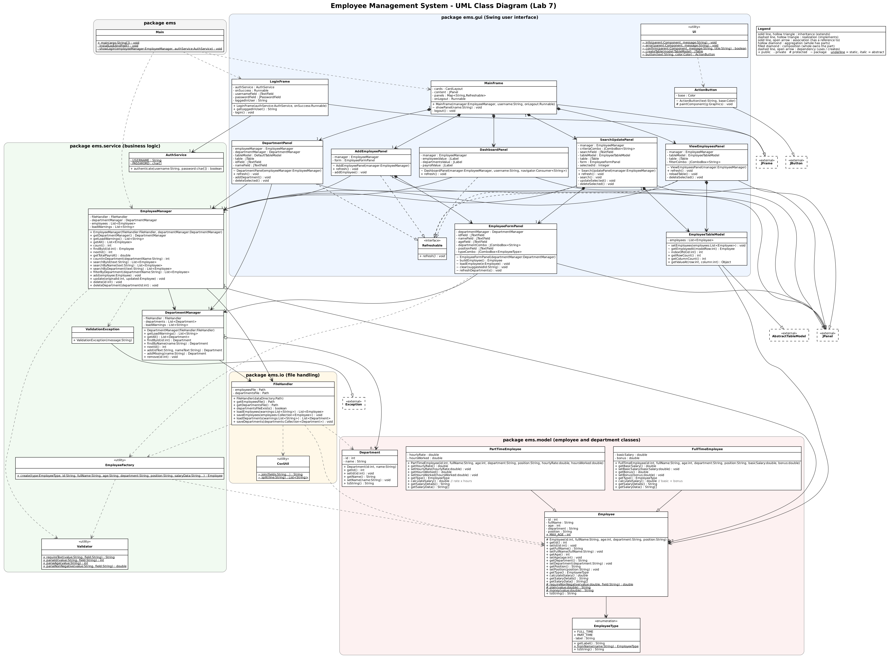

# Employee Management System (EMS)

A desktop application written in **Java Swing** for managing a company's employees and departments.
It was built as a lab project for *Computer and Communications Programming II* (University of Alexandria, Faculty of Engineering) to practise object-oriented design: inheritance, polymorphism, abstraction and encapsulation, with a clean split between the user interface, the business logic and the file storage.

  


## Features

- **Login screen** with a fixed demo account, and logout back to the login screen.
- **Dashboard** with a welcome message, live statistics (employees, departments, monthly payroll) and shortcuts.
- **Add employees** of two types. The salary fields change with the type:
  - Full-Time: basic salary + bonus
  - Part-Time: hourly rate x hours worked
- **View all employees** in a sortable table, filter by department, see the correct monthly salary for each type, delete the selected one.
- **Search and update**: search by employee ID, name or department (case-insensitive), select a result, edit it in the form and update or delete it. You can even change an employee's type.
- **Department management**: add and delete departments. Duplicate IDs and names (ignoring case) are rejected, and a department that still has employees cannot be deleted.
- **Persistent data**: everything is saved to CSV files after each change and loaded again at start-up.
- **Input validation** with clear error messages (details below).

## Screenshots

| Add employee | Search and update |
|---|---|
|  |  |

| Validation error | Delete confirmation |
|---|---|
|  |  |

More screenshots are in [`screenshots/`](screenshots/).

## Quick start

Requirements: **JDK 11 or newer**. No external libraries.

```bash
# Linux / macOS
javac -encoding UTF-8 -d out $(find src -name '*.java')
java -cp out ems.Main
```

```bat
:: Windows (Command Prompt)
dir /s /b src\*.java > sources.txt
javac -encoding UTF-8 -d out @sources.txt
java -cp out ems.Main
```

Or run `./compile_and_run.sh` (Linux/macOS) or `compile_and_run.bat` (Windows).
Start it from the project folder, because the `data/` folder is created there.

**Demo login:** username `admin`, password `admin123`.

## Design

The code is split into four packages, and each layer only talks to the one below it:

```
src/ems/
  Main.java        entry point: loads data, shows the login screen
  model/           Employee (abstract), FullTimeEmployee, PartTimeEmployee, EmployeeType, Department
  service/         EmployeeManager, DepartmentManager, EmployeeFactory, Validator,
                   ValidationException, AuthService          (business logic, no Swing)
  io/              FileHandler, CsvUtil                      (reading and writing files)
  gui/             LoginFrame, MainFrame, panels, table model (Swing only, no business logic)
```

### OOP concepts

| Concept | Where it is used |
|---|---|
| Encapsulation | `Employee` and `Department` keep fields private and validate them in setters. |
| Inheritance | `FullTimeEmployee` and `PartTimeEmployee` extend the abstract `Employee`. |
| Polymorphism | `calculateSalary()` is overridden per type. The table, the payroll total and the file writer only use `Employee` references. |
| Abstraction | `Employee` is abstract. `Refreshable` is an interface implemented by every screen. |

To add a new employee type you need one `EmployeeType` constant, one new subclass of `Employee`, and one `case` in `EmployeeFactory`.

The full class diagram is in [`UML/EMS_class_diagram.pdf`](UML/EMS_class_diagram.pdf) (PNG version: [`UML/EMS_class_diagram.png`](UML/EMS_class_diagram.png)).



## Data storage

Data is stored as UTF-8 CSV files in `data/` (created automatically on first run, with five default departments).

```
# data/employees.csv
type,id,fullName,age,department,position,salary1,salary2
FULL_TIME,1,Ahmed Hassan,30,IT,Software Engineer,15000,2000
PART_TIME,2,Sara Mohamed,24,Human Resources,HR Assistant,100,80
```

- `type` decides which class is rebuilt on load. For `FULL_TIME`, `salary1`/`salary2` are basic salary and bonus. For `PART_TIME` they are hourly rate and hours worked.
- Fields with commas or quotes are quoted, so names like `Laila, "Lili" Samir` work.
- Saves go to a temporary file first and are then moved over the real file. If saving fails, the change is undone in memory and an error is shown.
- Damaged lines are skipped on load, reported in a warning, and a `.bak` copy of the file is kept.

## Validation rules

- Required fields cannot be empty.
- Employee and department IDs: positive whole numbers, unique.
- Age: whole number from 1 to 120.
- Salary, bonus, hourly rate, hours: non-negative numbers (`NaN`, `Infinity` and `12d` are rejected).
- The department must exist in the department list.
- Update/Delete without a selection shows a message; delete asks for confirmation.

## Tests

```bash
javac -encoding UTF-8 -cp out -d testout tests/ems/BackendTests.java
java -cp out:testout ems.BackendTests
```

`BackendTests` runs 93 checks (salary formulas, validation, duplicate IDs, search, save and reload, corrupt files).
`tests/ems/GuiDriver.java` drives the real window (types, clicks, reads the table) and was used to produce the screenshots; it needs a display (on Linux without one, use `xvfb-run`).

## License

Educational project. Add a license of your choice (for example MIT) before sharing publicly.
